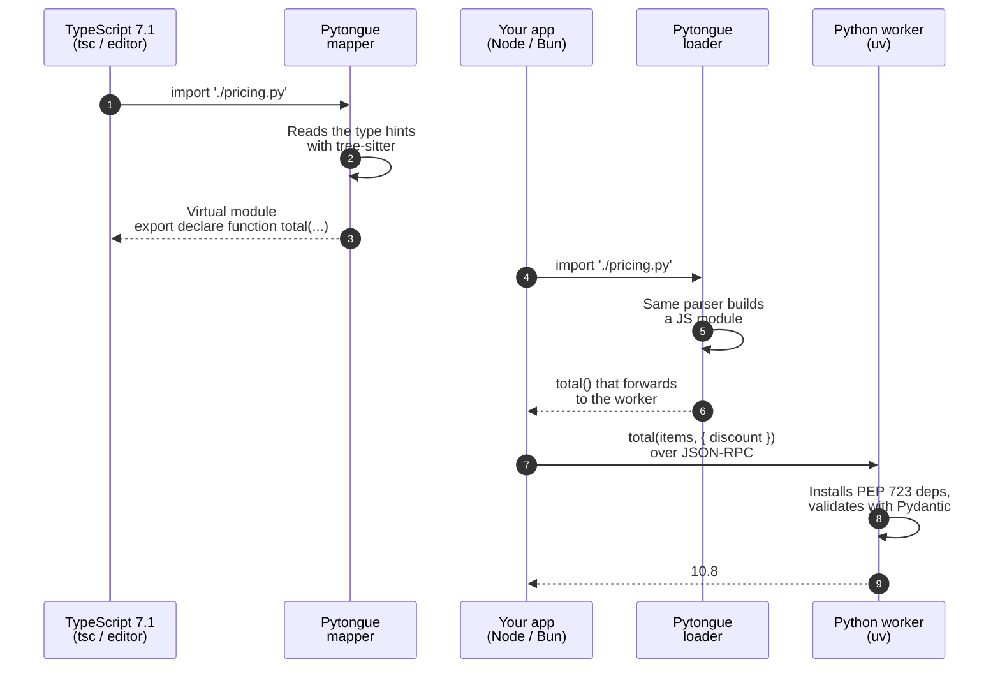

<div align="center">

<h1>Pytongue</h1>

<h3>Import Python from TypeScript. Fully typed. Actually runs.</h3>

<p>
  Write a function in Python. Import it in TypeScript.<br>
  Get autocomplete, type errors and go-to-definition from your type hints,<br>
  then call it and get a real result from real Python.
</p>

<p><b>No HTTP server. No codegen step. No hand-written <code>.d.ts</code>.</b></p>

</div>

```python
# pricing.py
from pydantic import BaseModel

class Item(BaseModel):
    name: str
    price: float
    qty: int = 1

def total(items: list[Item], *, discount: float = 0) -> float:
    return sum(i.price * i.qty for i in items) * (1 - discount)
```

```ts
// app.ts
import { total } from './pricing.py';

await total([{ name: 'Coffee', price: 4.5, qty: 2 }, { name: 'Bagel', price: 3 }], { discount: 0.1 });
// → 10.8
```

<p align="center">That's it. TypeScript sees the Python file as a typed module:</p>

```ts
declare function total(items: Item.Input[], kwargs?: { discount?: number }): Promise<number>;
```

<p align="center">
  Pass <code>price: 'free'</code> and <code>tsc</code> fails before you ship.<br>
  Bypass the types and Pydantic rejects the call at runtime.
</p>

<br>

<h2 align="center">Why Pytongue</h2>

<div align="center">

| | |
| :---: | :---: |
| **Python's ecosystem, TypeScript's DX** <br> numpy, pandas, scikit-learn, any PyPI package, called from your TS app. | **Types from your type hints** <br> `def`, `BaseModel`, `TypedDict`, `Enum`, `Literal`, `Optional`, all mapped to real TS types. |
| **Errors land in the `.py` file** <br> Type errors, hover and go-to-definition point at the Python source. | **Validated at the boundary** <br> Every call is checked by Pydantic. Bad input never reaches your function. |
| **Dependencies inside the file** <br> Declare them in a PEP 723 block and [uv](https://docs.astral.sh/uv/) installs them on the first call. | **Async, concurrency, streaming** <br> `async def` runs concurrently, and generators become `for await` loops. |
| **Type-checking needs no Python** <br> The `.py` file is parsed with tree-sitter, so CI and editors don't need Python installed. | **One parser, zero drift** <br> Types and runtime come from the same analysis, so they always agree. |

</div>

<br>

<h2 align="center">Real examples</h2>

<p align="center">Every snippet below is copied from a project that type-checks and runs.</p>

<h3 align="center">Data science from a Node backend</h3>

```python
# stats.py
# /// script
# dependencies = ["numpy"]
# ///
import numpy as np

def describe(values: list[float]) -> dict[str, float]:
    a = np.array(values)
    return {"mean": float(a.mean()), "std": float(a.std()), "p95": float(np.percentile(a, 95))}
```

```ts
import { describe } from './stats.py';

const latency = await describe([12, 15, 11, 30, 14]);
// → { mean: 16.4, std: 6.9455…, p95: 26.99… }        latency: Record<string, number>
```

<h3 align="center">Any PyPI package, zero setup</h3>

```python
# slug.py
# /// script
# dependencies = ["python-slugify"]
# ///
from slugify import slugify

def to_slug(title: str) -> str:
    return slugify(title)
```

```ts
import { to_slug } from './slug.py';

await to_slug('Olá, Mundo! TypeScript + Python'); // → "ola-mundo-typescript-python"
```

<h3 align="center">Generators become async iterables</h3>

```python
# fib.py
from collections.abc import Iterator

def fibonacci(limit: int) -> Iterator[int]:
    a, b = 0, 1
    while a < limit:
        yield a
        a, b = b, a + b
```

```ts
import { fibonacci } from './fib.py';

for await (const n of fibonacci(100)) console.log(n); // 0 1 1 2 3 5 8 13 21 34 55 89
```

<p align="center">Items are pulled one at a time. <code>break</code> closes the Python generator.</p>

<h3 align="center">Python errors, as typed JS errors</h3>

```ts
import { PythonError, PythonValidationError } from 'pytongue';

try {
  await total([{ name: 'Tea', price: 'free' as any }]);
} catch (e) {
  if (e instanceof PythonValidationError) console.log(e.errors); // Pydantic's errors()
  else if (e instanceof PythonError) console.log(e.pyType, e.traceback); // 'ValueError', ...
}
```

<br>

<h2 align="center">How it works</h2>



<div align="center">

**Types (1 to 3).** TypeScript 7.1 hands every `.py` import to Pytongue's [content mapper](https://github.com/microsoft/TypeScript/pull/63936). The mapper reads the type hints and answers with a virtual TypeScript module, with every name mapped back to the Python source. No Python runs at this point.

**Runtime (4 to 6).** A tiny preload parses the same file with the same parser. It turns the import into a JS module whose functions forward each call to a Python worker.

**Worker (7 to 9).** There is one long-lived process per file. uv provisions it from the file's PEP 723 block, falling back to the nearest `pyproject.toml`. Arguments are validated with Pydantic, and results come back as JSON over a private channel, so `print()` never breaks anything.

</div>

<br>

<h2 align="center">Get started</h2>

<p align="center"><b>1.</b> Install Pytongue and TypeScript 7.1</p>

```bash
npm i pytongue
npm i -D typescript@beta
```

<p align="center"><b>2.</b> Tell TypeScript about <code>.py</code> files in <code>tsconfig.json</code></p>

```jsonc
{
  "compilerOptions": { "module": "nodenext", "strict": true },
  "contentMappers": [{ "package": "pytongue", "extensions": [".py"] }]
}
```

<p align="center"><b>3.</b> Type-check and run</p>

```bash
tsc --noEmit --runExternalCode               # types, straight from your hints
node --import pytongue/register app.ts       # Node 24
bun --preload pytongue/register app.ts       # Bun
```

<p align="center">
  To run code you need <a href="https://docs.astral.sh/uv/getting-started/installation/">uv</a>. Type-checking needs neither uv nor Python.<br>
  <a href="./examples/basic">examples/basic</a> is a complete project that runs on both runtimes.
</p>

<br>

<h2 align="center">Node and Bun</h2>

<p align="center">
  The same code runs on both. Two things differ: how the preload is loaded,<br>
  and which TypeScript syntax the runtime itself accepts.
</p>

<div align="center">

| | Node | Bun |
| :--- | :--- | :--- |
| **Version** | 24 or later | tested on 1.4 |
| **Load the preload** | `node --import pytongue/register app.ts` | `bun --preload pytongue/register app.ts` |
| **Load it once for every command** | `NODE_OPTIONS="--import pytongue/register"` | `preload = ["pytongue/register"]` in `bunfig.toml`, then plain `bun app.ts` |
| **Your `.ts` files** | Node only strips types, so use erasable syntax: no `enum`, `namespace` or constructor parameter properties. Import other `.ts` files with their extension. | Any TypeScript. |
| **`tsconfig.json`** | `"module": "nodenext"`, plus `"erasableSyntaxOnly": true` so `tsc` catches what Node cannot run (and `"allowImportingTsExtensions": true` when you import `.ts` files) | `"module": "nodenext"`, or `"module": "preserve"` with `"moduleResolution": "bundler"` |

</div>

<p align="center">A <code>tsconfig.json</code> that works for both:</p>

```jsonc
{
  "compilerOptions": {
    "module": "nodenext",
    "strict": true,
    "noEmit": true,
    "erasableSyntaxOnly": true,
    "allowImportingTsExtensions": true
  },
  "contentMappers": [{ "package": "pytongue", "extensions": [".py"] }]
}
```

<br>

<h2 align="center">Python → TypeScript</h2>

<div align="center">

| Python | TypeScript |
| :--- | :--- |
| `def f(...) -> T` / `async def` | `(...) => Promise<T>` |
| function with `yield` | `(...) => AsyncIterable<T>` |
| `class M(BaseModel)` | `interface M` (output) + `M.Input` (defaults optional) |
| `TypedDict`, `Enum`, `Literal[...]` | object type, literal union |
| `str` · `int`, `float` · `bool` · `None` | `string` · `number` · `boolean` · `null` |
| `X \| None`, `Optional[X]` | `X \| null` |
| `list[T]`, `tuple[A, B]`, `dict[str, V]` | `T[]`, `[A, B]`, `Record<string, V>` |
| `datetime`, `UUID`, `Decimal` | `string` (their JSON form) |
| required params / params with defaults | positional / trailing `{ ...kwargs }` object |
| no type hint | `unknown`, with the reason in hover |

</div>

<p align="center">
  <code>Field(alias=...)</code>, inheritance, docstrings (as JSDoc), forward references,<br>
  type aliases, <code>__all__</code> and relative imports between <code>.py</code> files all work.
</p>

<p align="center">
  Want every hint mandatory? Add <code>"options": { "strict": true }</code> to the mapper entry:<br>
  each missing or untranslatable hint then becomes a type error on the Python line.
</p>

<br>

<h2 align="center">Editor setup</h2>

<p align="center">
  Content mappers run only in TypeScript 7's own language server, started with <code>runExternalCode</code>.<br>
  An editor still on the old tsserver says <code>Cannot find module './x.py'</code>.
</p>

<div align="center">

| Editor | Setup |
| :--- | :--- |
| **VS Code** | TypeScript Native Preview extension, opened as a trusted workspace |
| **Zed** | the `tsgo` extension, pointed at your project's TypeScript 7.1 binary (snippet below) |
| **Any LSP client** | `tsc --lsp --stdio` with `initializationOptions: { "runExternalCode": true }` |

</div>

<details>
<summary><b>Zed: <code>.zed/settings.json</code></b></summary>

```jsonc
{
  "languages": {
    "TypeScript": { "language_servers": ["typescript-ls", "!vtsls", "..."] }
  },
  "lsp": {
    "typescript-ls": {
      "binary": {
        "path": "/absolute/path/to/project/node_modules/@typescript/typescript-linux-x64/lib/tsc",
        "arguments": ["--lsp", "--stdio"]
      },
      "initialization_options": { "runExternalCode": true }
    }
  }
}
```

The `tsgo` extension downloads TypeScript 7.0 for itself, and 7.0 has no content mappers. That is why `binary.path` points at your project's 7.1.

</details>

<br>

<h2 align="center">Runtime, in detail</h2>

<div align="center">

| | |
| :--- | :--- |
| **Workers** | one per `.py` file, started on first call, kept alive, never blocking process exit |
| **Concurrency** | `async def` runs concurrently; sync functions run in order on a dedicated thread |
| **Errors** | `PythonError` (exception), `PythonValidationError` (bad input), `PythonWorkerError` (crash or missing uv) |
| **Safety** | NaN, Infinity and ints beyond ±2⁵³ raise instead of arriving corrupted; calls are never retried |
| **Crashes** | the next call starts a fresh worker; a module that fails to import is not respawned until you fix it |
| `PYTONGUE_UV` | path to the uv binary (default `uv`) |
| `PYTONGUE_PREFETCH` | generator items requested ahead (default `1`) |

</div>

<br>

<h2 align="center">Status</h2>

<p align="center">
  Pytongue is <b>experimental</b> and built on the <b>TypeScript 7.1 beta</b> content mapper API, which may still change.<br>
  Not yet supported: classes with methods, module-level constants, generic (<code>TypeVar</code>) signatures, bundlers.<br>
  Tested on Linux with Node 24 and Bun.
</p>

<br>

<div align="center">

**Python for the brains. TypeScript for everything else.**

</div>
